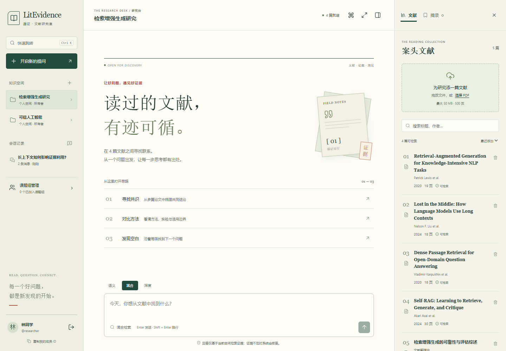

# LitEvidence · 科研文献证据问答

面向研究生与课题组的全栈 RAG 文献问答系统。上传论文 PDF，围绕一个研究主题提问，获得附带**文献名称、页码和原文片段**的回答，方便比较观点、核对证据与整理研究摘录。

**上传论文 → 构建索引 → 检索证据 → 流式回答 → 回到原文**



*“纸上研究室”工作台，截图使用演示数据。*

## 在线试用

访问 **[LitEvidence Demo](https://47.238.160.17)**，注册后即可上传小型 PDF 并体验带引用的问答。

- 每个用户每天最多问答 10 次、上传 3 次
- 单个 PDF 最大 5 MiB、30 页
- 这是香港 ECS 试用实例，公网 IP 可能因实例变更而变化
- 请只上传可以公开的论文；文件内容会发送给配置的模型服务商处理

## 核心能力

- **文献入库**：PDF 异步解析、页码感知分段、内容去重、索引状态与失败重试。
- **混合检索**：Lucene BM25 + Qdrant 向量检索，经 RRF 融合，可选外部重排序。
- **证据问答**：SSE 流式生成、页码级引用与原文侧注；检索证据未达到要求时拒答。
- **研究整理**：会话保存与恢复、文献搜索、专注阅读、证据收藏与 Markdown 导出。
- **协作隔离**：JWT 登录、个人及课题组知识空间、所有者／编辑者／只读三级权限。

## 技术栈

| 模块 | 技术 |
| --- | --- |
| 前端 | React 19 · TypeScript · Vite · Nginx |
| 后端 | Java 17 · Spring Boot 3.5 · Spring AI 1.1 |
| 文献与检索 | PDFBox · Lucene BM25 · Qdrant · RRF |
| 数据与工程 | MySQL · Redis · Flyway · Micrometer · Docker Compose |
| 模型服务 | SiliconFlow BGE-M3 / Reranker · DeepSeek API |

## 快速启动

安装 Docker 与 Compose，复制配置并填写数据库密码、`APP_AUTH_SECRET`、`SILICONFLOW_API_KEY`、`DEEPSEEK_API_KEY` 和 `RERANK_API_KEY`（使用同一 SiliconFlow 账户时可填相同 Key）：

```bash
cp .env.production.example .env.production
# 编辑 .env.production 后启动完整应用
docker compose --env-file .env.production -f compose.prod.yaml up -d --build
```

Windows PowerShell 将 `cp` 换成 `Copy-Item` 即可。打开 [localhost:8088](http://localhost:8088)，注册账户、创建知识空间并上传论文。完整问答需有效的模型 API Key，模型调用按服务商规则计费。

本地开发、其他模型配置与接口示例见[开发指南](docs/getting-started.md)；对外演示建议采用[单台云服务器部署](docs/deployment.md)。

## 评测与边界

已记录的固定评测包含 12 篇论文、40 条证据问题和 10 条拒答问题：**Top-5 证据命中率由 42.5% 提升至 87.5%**（纯向量 → 混合检索加重排）。命中率按 40 条可回答问题统计，结果仅代表该语料与配置，详见[评测报告](docs/benchmark.md)。

目前支持含文本层的 PDF（单篇最多 50 MB / 500 页），暂不支持扫描件 OCR。历史会话可恢复文字，引用详情尚不随历史会话恢复；收藏摘录仅保存在当前浏览器。

## 更多文档

[开发与接口](docs/getting-started.md) · [部署建议](docs/deployment.md) · [评测复现](evaluation/README.md) · [前端设计](docs/frontend-design.md) · [领域模型](CONTEXT.md) · [架构决策](docs/adr)
